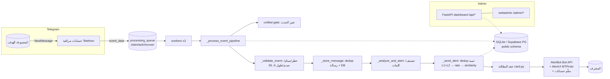

# ARCHITECTURE — Telegram_BR7 (محدثة v12.2.0)

## 1. النظرة العليا

خدمة بايثون واحدة (عملية واحدة، event loop واحد، uvloop اختياري) تعمل على Render Free:
مراقبة مجموعات تيليجرام عبر حسابات مستخدمين (Telethon MTProto) → خط أنابيب معالجة أحداث
→ فلترة/تصنيف → تنبيه موحد لمشرف عبر بوت Bot API (مع سلّم احتياطي) → لوحتا إدارة
(FastAPI واحدة بمنفذ واحد).



## 2. حدود الوحدات (اتجاه الاعتماديات)

| الطبقة | الوحدات | يستورد | لا يستورد أبداً |
|---|---|---|---|
| سياسات ن pure-sync | `unified_alerts/*`, `security.py`, `dedup.py`, `similarity.py`, `clauses.py` | config فقط | telethon/dashboard/بعضها بعض |
| نواة المعالجة | `monitors.py`, `filter_engine.py`, `classifier.py`, `message_context.py`, `contact_target.py`, `sender_resolver.py`, `nav_resolver.py`, `antispam.py`, `negative_memory.py`, `reply_fix.py`, `alert_ui.py` | الطبقة النيرة + telethon | dashboard, webadmin |
| التخزين | `database.py` (SQLite/PG مزدوج)، `dashboard_store.py` | unified_alerts.stats | monitors |
| الواجهة | `dashboard.py` (API + قوالب)، `webadmin/*` (SPA + REST) | database, security | telethon handlers |
| التركيب | `main.py` | كل ما سبق | — |

**قيد معماري معلن**: `dashboard.py` لا يستورد `webadmin` (فصل نشر اختياري) — الوسيط المشترك
المسموح هو `security.py` (هكذا وحّدنا محلل IP دون كسر القيد).

**حلقات الاستيراد التاريخية** (message_context ↔ alert_bot، dashboard ↔ dashboard_store):
تُدار بـاستيرادات داخل الدوال (function-level imports) — مُتحقق: لا فشل استيراد وقت إقلاع
(1033/1033 محاكاة إقلاع تاريخية + المجموعة الحالية). ليست عيباً — نمط مقصود موثق.

## 3. دورة حياة الرسالة (العقد §8)

```
UPDATE RECEIVED (handler hot path — بلا I/O شبكي)
→ VALIDATION (is_blocked/spam/echo/طول 6..65 عبر FilterPolicy — مصدر حقيقة واحد)
→ CONTEXT CONSTRUCTION (جامع مركزي v11.7.1 — فشله لا يسقط التنبيه)
→ DEDUPLICATION (رسالة: try_insert_message + LRU؛ تنبيه: dedup L1 ذاكرة + L2 DB PK)
→ DATABASE PERSISTENCE (messages/alerts/dedup/intel)
→ ALERT DECISION (تصنيف + كلمات + بوابة العمر ثانية عند الإرسال)
→ ALERT DELIVERY (Bot API HTML + أزرار → AlertUI MTProto → سلّم حسابات → DLQ)
→ STATUS TRACKING ([ALERT] structured log + dispatch columns + unified_stats)
→ ERROR RECOVERY (DLQ بفهم FloodWait + recover_stale_inflight + إيصال alerts للقرار)
```

ضمانات التسليم: **at-least-once مع dedup مرئي-للمستخدم** (exactly-once غير ممكن مع API خارجي —
موثق بصدق بدل ادعاء كاذب).

## 4. الطوابير والمهام الخلفية

* `processing_queue` (DB): claim بلا حذف → ack بعد اكتمال → استرداد عالق (600s) → dead بعد 3 محاولات.
* حلقات دورية في main.py: استرداد in-flight (120s)، purge طابور منتهي (7200s)، تنظيف dedup، كتابة db_writer، نسخ احتياطي.
* كل الحلقات: fail-safe مضبوط + عدادات صادقة تظهر في `/health/full`.

## 5. القرارات المعمارية الثابتة (لماذا لا نغيرها)

1. **عملية واحدة** — Plan Free (512MB)؛ فصل الخدمات يرفع التكلفة.
2. **SQLite→PG تلقائي** بالكشف عن DATABASE_URL — يخدم التطوير والإنتاج معاً.
3. **قيد dashboard↛webadmin** — نشر اللوحة الإدارية اختياري.
4. **unified_alerts بلا I/O** — قابلة للاختبار وحدوياً بلا شبكة.
5. **السلّم التنبيهي لا يرسل نصاً بلا أزرار كنجاح** — تدهور صادق موثق فقط.
